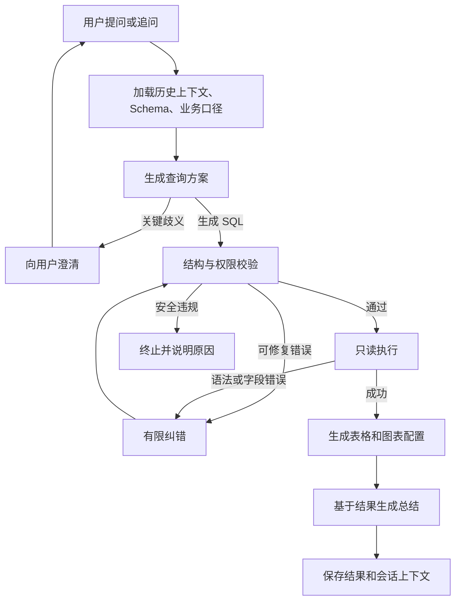

# WhiteBearDataAgent：面向学习与开源展示的 TextToSQL 项目

## 1. 项目目标与技术选择

首版实现完整的自然语言问数流程：理解数据库结构和业务口径，生成并校验 SQL，自动执行，返回表格、图表和总结，支持多轮追问。

当前已实现第一阶段和第二阶段的查询闭环，包括结构浏览、SQL 生成与校验、只读执行、有限纠错、持久化历史及前端表格。原有 JSON 接口保留；第三阶段已补充 SSE 实时进度、停止分析、断线清理、取消状态持久化，以及多轮条件继承、覆盖和澄清续接。图表及结果总结也已实现，包括图表类型切换、有限样本与十进制摘要、总结失败时保留查询结果。当前行为详见 [查询流程与接口](query-workflow.md)，下文保留首版整体设计。

重点是完整体验、清晰的执行过程、可靠的查询和可复现的评测。首版按本地单用户运行设计。

此次调整确定为：

- **采用本地直接启动方式**，通过 Python 自带的 venv、pip、npm 和本地 PostgreSQL 运行。
- **业务数据动态生成**，默认覆盖运行当天及过去一年的数据。
- **UI 使用自定义样式**，引入少量无样式组件处理复杂交互。

| 层次 | 技术选择 | 用途 |
|---|---|---|
| 前端 | Vue 3、TypeScript、Vite、Pinia | 页面、状态管理、流式交互 |
| UI | 自定义 Vue 组件、CSS 变量、scoped CSS | 建立统一视觉风格 |
| 基础交互 | Reka UI、Lucide 图标 | 弹窗、下拉菜单、焦点管理和图标 |
| 图表 | vue-echarts | 分析结果可视化 |
| 后端 | FastAPI、Pydantic | 异步接口与数据契约 |
| Agent | LangGraph、LangChain | 状态编排、模型适配、结构化输出 |
| 模型 | DeepSeek `deepseek-flash` | 查询生成、问题澄清、结果总结 |
| 数据访问 | SQLAlchemy 2、psycopg 3、Alembic | 应用持久化、业务查询、迁移 |
| SQL 校验 | SQLGlot | PostgreSQL SQL 解析与结构检查 |
| 存储 | PostgreSQL | 会话、运行记录、业务数据 |

模型名、API 地址和 Key 使用环境变量配置。LangChain 负责模型接入和消息构造，流程状态统一交给 LangGraph 管理。

## 2. 产品体验与 Agent 流程

### UI 设计

采用轻量的数据分析工作台风格：

- 浅灰背景 `#F8FAFC`、白色内容面板、深色文字 `#0F172A`。
- 蓝色 `#2563EB` 作为强调色，边框使用 `#E2E8F0`。
- 使用统一的间距、圆角、字体层级和图表配色。
- 首版提供浅色主题，重点完善桌面体验。

页面分为三个区域：

| 区域 | 内容 |
|---|---|
| 左侧会话区 | 新建会话、历史会话、数据源选择 |
| 中间对话区 | 问题输入、推荐问题、运行进度、澄清和总结 |
| 右侧分析区 | 表格、图表、SQL、业务口径和执行轨迹 |

桌面宽度达到 1280px 时展示三栏；较窄屏幕将分析区改为抽屉，移动端再折叠会话侧栏。

自行封装按钮、输入框、消息卡片、标签页、状态提示和结果表格。表格提供排序、横向滚动和分页，默认每页 50 行。

[Reka UI](https://reka-ui.com/docs/overview/introduction)用于弹窗、下拉菜单、提示框等交互，提供键盘操作与焦点管理；组件外观通过项目自己的 CSS 控制。

另外提供数据结构页，查看表、字段、类型和关联关系，并补充中文说明及业务含义。

### Agent 流程



节点按上下文加载、查询生成、SQL 校验、查询执行、纠错、展示构建、总结与保存划分。正常查询主要需要两次模型调用：生成查询、总结结果。

执行轨迹记录节点状态、耗时、SQL 和诊断摘要。

### 行为规则

- 每轮执行一条查询，支持 JOIN、CTE、聚合和窗口函数。
- 首次生成失败后最多修复两次；安全违规直接终止。
- 未指定时间范围时默认最近 30 天，并展示这一假设。
- 指标口径存在歧义或关键实体无法确定时先澄清。
- 追问继承上一轮明确的指标、筛选和分组；当前问题指定的内容覆盖旧条件。
- 图表切换复用已有结果；统计口径或过滤条件变化重新查询。
- 切换数据源时新建会话。
- 空结果正常展示；分析总结依据实际结果，避免无依据的因果判断。

## 3. 数据生成、存储与执行边界

### 动态业务数据

内置电商数据生成脚本，包含客户、分类、商品、订单、订单明细和退款六张表。

默认生成参数：

| 参数 | 默认行为 |
|---|---|
| 参考时间 | 运行时的当前时间，使用 `Asia/Shanghai` |
| 数据覆盖 | 过去 365 天，截至参考时间 |
| 订单数量 | 10,000 笔 |
| 随机种子 | `42` |
| 最近数据 | 确保最近 7 天、30 天有销售记录，当天记录不超过参考时间 |

数据包含可观察的周内波动、季节变化、品类差异和退款情况，让趋势、排名和占比分析有展示价值。

生成过程保证：

- 下单、支付、退款时间顺序合理。
- 明细金额与订单金额一致。
- 累计退款不超过对应明细的实付金额。
- 金额使用 `NUMERIC`。
- 相同参考时间、随机种子和参数产生相同数据。

计划提供以下命令：

```bash
python -m app.cli business generate --days 365 --orders 10000 --seed 42
```

默认读取当前时间。评测时可固定参考时间：

```bash
python -m app.cli business generate --as-of 2026-10-08T12:00:00+08:00 --seed 42
```

生成命令在已有数据时提示退出；显式传入 `--reset` 才重新生成，操作范围限定在项目业务库的受管表。

脚本完成后输出数据覆盖范围、各表行数以及最近 30 天的订单和销售统计。初始化与生成数据无需模型 API Key。

界面显示业务数据的生成时间和覆盖范围。日常问数使用真实当前时间，评测显式注入固定参考时间。

### 业务口径

通过版本化 YAML 保存指标定义、同义词、统计粒度和关联关系：

| 指标 | 默认口径 |
|---|---|
| 实付销售额 | 按支付时间归属，汇总订单明细实付金额 |
| 支付订单数 | 统计已支付订单的去重数量 |
| 客单价 | 实付销售额 ÷ 支付订单数 |
| 成功退款额 | 按退款成功时间归属，汇总成功退款金额 |

明确订单与明细的统计粒度，避免 JOIN 后重复计数。销售额与退款额采用不同时间归属时，在结果中注明。

### 应用存储与数据接入

同一 PostgreSQL 实例中设置独立的应用库和业务库，分别使用访问账号：

- 应用库保存会话、消息、运行记录、数据结构说明和反馈。
- Agent 使用专用只读账号查询业务库。
- LangGraph 使用 `AsyncPostgresSaver` 保存图状态。

主要应用表为 `conversations`、`messages`、`analysis_runs`、`datasource_metadata`、`feedback`，以及 checkpoint 表。

运行记录保存 SQL、Schema 版本、指标引用、有限大小的结果、图表配置、耗时、错误和 Token 用量。

自有 PostgreSQL 数据源通过服务端配置接入，连接串引用环境变量。前端补充的结构说明保存在应用库。

首版每个数据源配置最多 20 张可分析表，全量提供允许访问的结构和业务说明；大规模 Schema 检索作为后续扩展。

### SQL 执行边界

SQLGlot 提供结构检查，数据库权限提供实际执行约束：

- 仅允许单条只读查询，同时检查 CTE 内部语句。
- 拒绝写操作、`SELECT INTO` 和多语句。
- 表、字段、Schema、函数采用允许列表。
- 使用只读事务，查询超时默认 10 秒，锁等待超时 2 秒。
- 最多返回 1,000 行、2 MB 行数据，并标记结果截断。
- 总结阶段使用最多 20 行样本及服务端计算的统计摘要。
- 连接凭据保存在后端配置中，运行日志记录请求 ID、错误码和耗时。

## 4. 接口与本地运行方式

### API 与结果契约

接口统一使用 `/api/v1` 前缀：

| 接口 | 用途 |
|---|---|
| `GET /datasources` | 列出数据源 |
| `GET /datasources/{id}/schema` | 查看结构及说明 |
| `POST /datasources/{id}/sync` | 刷新结构 |
| `PATCH /datasources/{id}/metadata` | 修改应用内的说明 |
| `POST /conversations` | 创建会话 |
| `GET /conversations/{id}` | 获取消息和历史分析 |
| `POST /conversations/{id}/messages` | 发起分析，以 SSE 返回进度和结果 |
| `GET /runs/{id}` | 获取 SQL、表格、图表、总结和运行统计 |
| `POST /runs/{id}/feedback` | 提交评价和纠错说明 |

前端使用 `fetch` 读取 SSE。事件包括运行开始、节点状态、SQL、结果、总结片段、澄清、完成和错误。

点击停止或连接断开时，后端取消运行、清理查询连接并记录中断状态。

Pydantic 定义主要契约，通过 OpenAPI 生成前端类型：

- `QueryDraft`：查询动作、SQL、指标、时间范围、假设和图表意图。
- `QueryResult`：列名、类型、数据行、行数、截断标志和耗时。
- `ChartSpec`：类型、横轴、纵轴、可选系列字段和标题。

首版支持折线图、柱状图和饼图。时间趋势默认折线图，分类比较默认柱状图，明确的占比分析且分类不超过八项时使用饼图。

前端根据受约束的 `ChartSpec` 构建 ECharts 配置。

### 本地启动

环境基线为 Python 3.12、Node.js 22.12 或以上版本、PostgreSQL 16 或以上版本。后端使用 Python 自带的 venv 创建虚拟环境，通过 pip 安装依赖；前端使用 Node.js 自带的 npm 管理依赖。

首次运行流程：

1. 安装运行环境，复制示例配置并填写数据库连接及 DeepSeek API Key。
2. 安装前后端依赖。
3. 运行初始化命令，创建数据库、访问账号、应用表和 checkpoint 表。
4. 运行业务数据生成命令。
5. 启动 FastAPI 和 Vite。

初始化凭据仅供初始化脚本使用，后端运行配置使用应用账号与业务只读账号。

开发模式下，Vite 代理 `/api` 到 FastAPI。展示模式下，前端构建为静态文件，由 FastAPI 同域托管，使用一个后端进程运行。

README 同时提供 Windows PowerShell 和 Linux/macOS 的安装、初始化及启动说明。

## 5. 工程质量、验收与交付顺序

### 工程组织

采用单仓库，按前端、后端、业务数据、评测和文档组织。

后端划分为 API、应用服务、Agent 图、数据源访问、模型适配和持久化模块。路由处理请求与响应，Agent 节点调用独立服务。

- Python：venv、pip、Ruff、mypy、pytest。
- 前端：npm、ESLint、Prettier、Vitest。
- 端到端验证：Playwright。
- CI：静态检查、单元测试、原生 PostgreSQL 集成测试、前端构建。

### 验收方案

| 类别 | 验证内容 |
|---|---|
| 数据生成 | 时间覆盖、最近 30 天数据、金额一致性、退款约束、固定参数复现、重置范围 |
| SQL 正确性 | 50 个固定问题，覆盖聚合、多表关联、排名、时间比较和退款口径 |
| 执行边界 | 多语句、写入 CTE、越权字段、危险函数、只读限制和超时 |
| 会话行为 | 条件继承与覆盖、澄清、纠错、空结果、截断和取消 |
| UI | 完整问数路径、键盘操作、抽屉布局、表格与图表展示、错误状态 |

SQL 评测按查询结果比较正确性，首版目标为达到 90%。评测固定参考时间、数据种子、Schema 和提示词版本。

日常 CI 使用模型桩验证工程行为；真实 DeepSeek 评测由配置 API Key 的开发者手动运行。

### 交付顺序

| 阶段 | 交付结果 | 完成标准 |
|---|---|---|
| 第一阶段：基础骨架 | 本地启动、数据库初始化、动态数据脚本、自定义 UI 基础组件 | 克隆后可生成近期数据并查看结构 |
| 第二阶段：查询闭环 | SQL 生成、校验、只读执行、纠错和运行记录 | 示例问题返回正确 SQL 和表格 |
| 第三阶段：产品体验 | SSE、多轮追问、澄清、图表、总结和执行轨迹 | 完整流程可演示，异常状态可理解 |
| 第四阶段：开源交付 | 评测报告、CI、截图、架构说明和贡献指南 | 新用户按 README 能完成首次问数 |

默认采用 MIT 许可证，提供中文 README 和英文项目简介。首版范围为本地单用户、PostgreSQL、单次查询与有限纠错；使用者自备 DeepSeek API Key。
